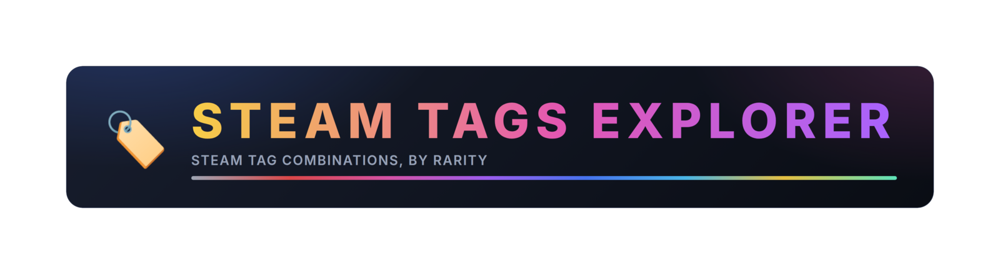
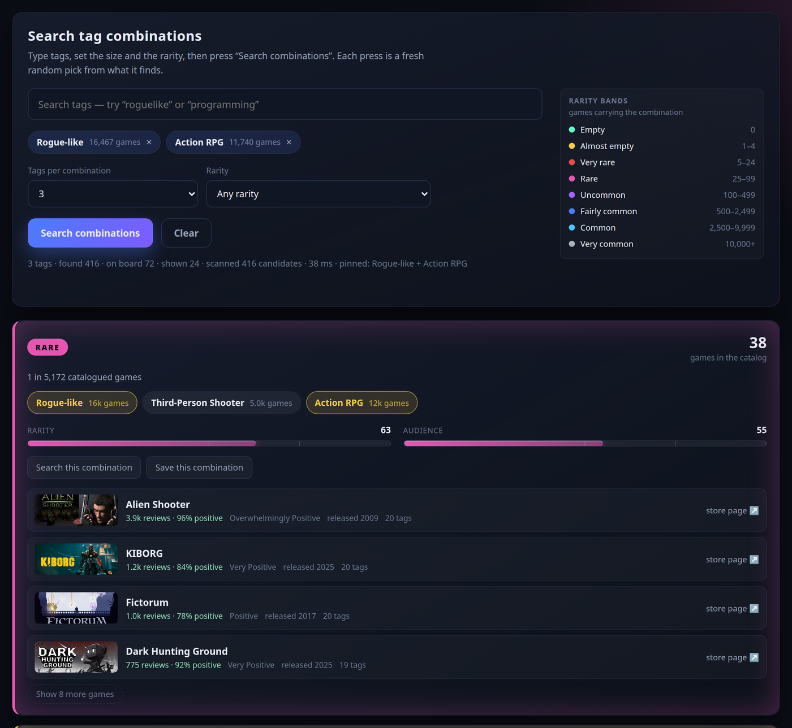
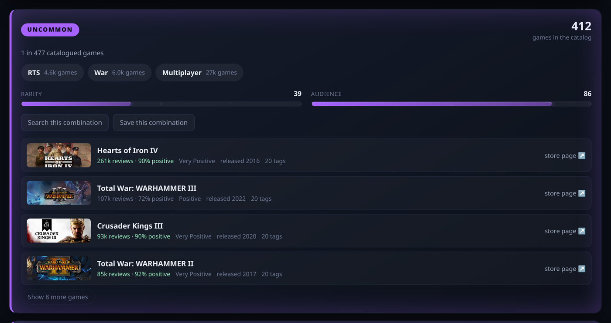
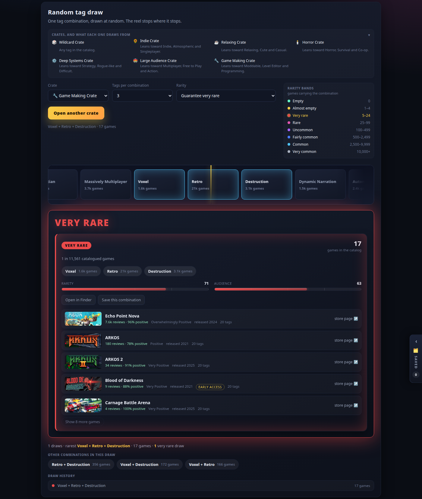
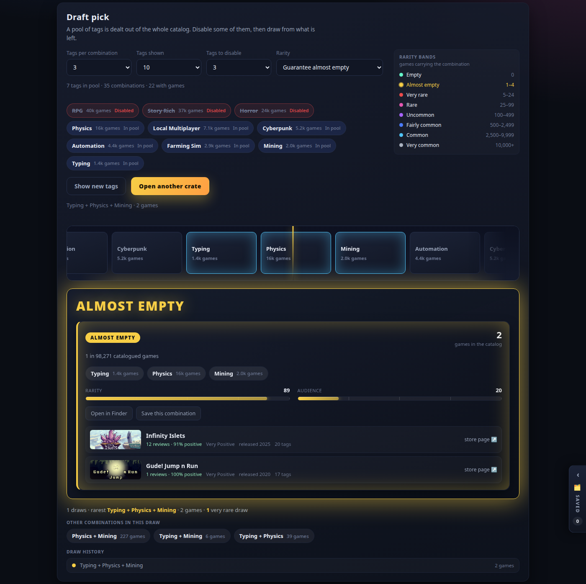
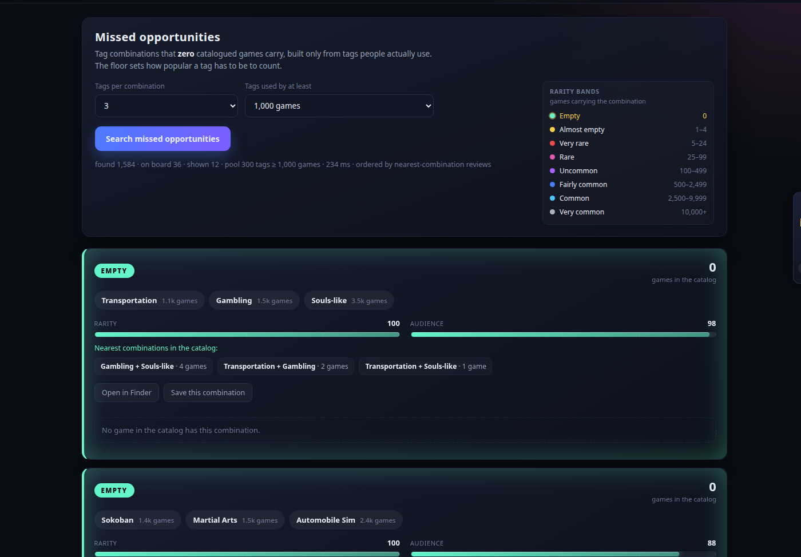
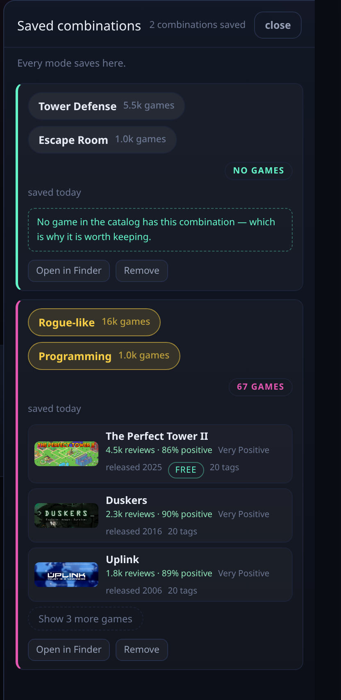

<p align="center">
  
</p>

Steam Tags Explorer answers questions about **tag combinations** using counts taken from Steam's own store
pages. Counts are exact, never estimates. Some of the questions it answers:

- How many catalogued games are both `Rogue-like` and `Action RPG` — and how many with `Co-op` added?
- Which 3-tag combinations sit between 5 and 24 games?
- What combination comes out of a crate that leans toward `Programming`?
- Which combinations does **no** catalogued game carry at all?

It is a curiosity tool. It does not help you make a game, and it does not generate assets, code or content.
What it is for is showing a designer a corner of the tag map nobody has looked at yet.

**Live site: <https://mickabrig7.github.io/steam-tags-explorer>.** Nothing to install, no account, no
build. The page downloads one file of about 7 MB — the catalog — indexes it in your browser in under a
second, and answers everything from that index for the rest of your visit. The header shows how big the
catalog is, when it was last read from Steam, and a switch for the sounds. Counts here run lower than
Steam's own tag pages, which also count DLC, bundles and demos.

## The four modes

### Finder



Type tags into the box. Spellings only have to be close: `storyrich` finds `Story Rich`, and `co+op` finds
`Co-op`. Choose how many tags a combination holds (2 to 5) and how rare you want it, then search. Results
come back as cards, and the line under the buttons reports what the search did:
`3 tags · found 416 · on board 72 · shown 24`, then how many candidates it scanned and how long it took. A
five-tag search is the slowest press on the page and takes a few seconds. Press again with the same settings
and you get a different set from the same answer.

### A result card



A card carries the count, its rarity band, the odds as a ratio, bars for rarity and audience, the tags it
is made of, and the games carrying it, each linked to its Steam page. Clicking a tag puts it in the tag
box, and clicking it again takes it out; nothing is searched until you press the button.

### Random draw



Pick one of seven crates, choose how many tags the combination should hold, and open it. The block above the
controls lists every crate and what it draws from. Under the reel you get what came out, the same
combination with one tag dropped, and your draws so far. A rarer combination spins longer.

### Draft pick



Tags are dealt out of the whole catalog and you switch some of them off; the draw uses what is left. The
line under the controls counts the pool: `7 tags in pool · 35 combinations · 22 with games`.

### Missed opportunities



Combinations that **zero** catalogued games carry. They are built only from tags people actually use: the
floor sets how many games a tag has to be carried by, from 250 to 10,000. Each card names the nearest
combinations that do exist, with their counts.

## Rarity

| Band | Games carrying the combination |
| --- | --- |
| Empty | 0 |
| Almost empty | 1–4 |
| Very rare | 5–24 |
| Rare | 25–99 |
| Uncommon | 100–499 |
| Fairly common | 500–2,499 |
| Common | 2,500–9,999 |
| Very common | 10,000+ |

Use the **Rarity** field to filter by band. The block beside it marks the bands that choice leaves in play,
and a choice the current search cannot reach is greyed out with its reason.

## Saved combinations



Every card carries a save button. Saved combinations sit in the panel pinned to the right edge, and one you
have saved is marked wherever it shows up again. They live in your browser: they survive a reload, and they
do not follow you to another device.

## Running it yourself

**Node.js 22.5 or newer** and this repository, and nothing else: no npm packages to install, no build step.
The files in `public/` are the site, byte for byte.

```bash
npm start                # http://127.0.0.1:8787/ — the whole app, on the data file in this repository
npm run update-snapshot  # ask Steam what is new or changed, fetch those pages, rewrite that file
npm run check-catalog    # answer 25 real questions out of it, and check its counts agree with each other
```

Everything answers from one committed file, `public/data/catalog.bin.gz` — about 7 MB compressed, 13 MB
unpacked — so a fresh clone is already a working app with real numbers.

`update-snapshot` fetches only the store pages that are new or changed. It leaves a game alone when its page
is gone or behind an age check, and it never writes a smaller catalog than the one it was given. Flags worth
knowing: `--dry-run 10`, `--limit 500`, `--new-only`, `--recheck 200`, and `--in`/`--out` to work on a copy.

The **Publish the site** workflow runs that command every third day, and whenever you start it by hand. It
reads at most 12,000 store pages, checks the result with those 25 questions before committing anything, and
then sends `public/` to GitHub Pages. Steam sometimes blocks a crawl coming from GitHub's addresses; when it
does, the committed file is left alone and the site keeps the numbers it had.

## Where your visit goes

The published site loads the page, its scripts and one data file from GitHub Pages — about 7 MB on the
first visit — and game rows load their header art from Valve's CDN. No accounts, no cookies, no analytics,
and nothing about a search leaves your browser. The local server binds to `127.0.0.1`.

## AI usage disclosure

Everything in this repository was written by AI, at the direction of a hardware engineer with no
web-framework background. There is no server framework, no build step, no front-end framework and no
third-party package: the surface is small on purpose, because it is one the author can reason about and
check by running it on their own hardware.

The model is [Qwen 3.8 Flash Next](https://huggingface.co/ISTA-DASLab/Qwen3.8-Flash-Next-GSQ-RCO-GGUF),
served by the [Strata](https://github.com/Niko1221/Strata) inference engine on a personal computer. No cloud
model and no API key are used, to build this or to run it: the app never calls a model, and the search runs
in your browser or on your own machine.

The project's intent is curiosity. It is not a tool for making games: it is not meant to assist game
development, it generates no assets, code or content, and its rarity numbers are not a business signal. It
exists to make an unexplored corner of the tag map visible, and leave something for a designer to think
about. "No game carries these three tags" is not a market opportunity.

## License

GPL-3.0-or-later — see [LICENSE](LICENSE). The license covers the code in this repository. It does not
cover the catalog: game names, tags and review counts are Valve's storefront data, and the store images the
interface loads come from Valve's CDN. Nothing here is affiliated with or endorsed by Valve. The updater
identifies itself as `SteamTagsExplorer/1.0` in its `User-Agent`, waits 250 ms between requests per worker,
and is meant for one person refreshing their own copy.

The internals — the file format, the search, and the checks that stand in for a test suite — are in
[AGENTS.md](AGENTS.md).
